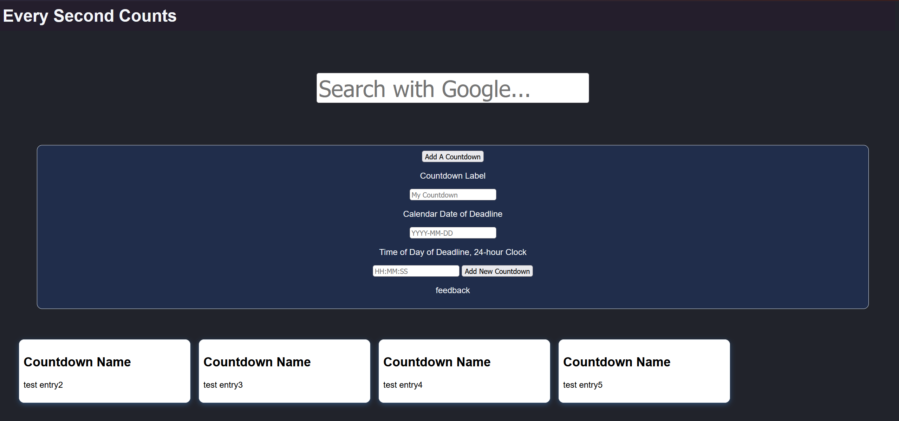
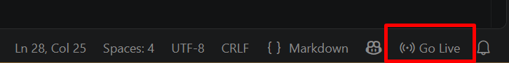
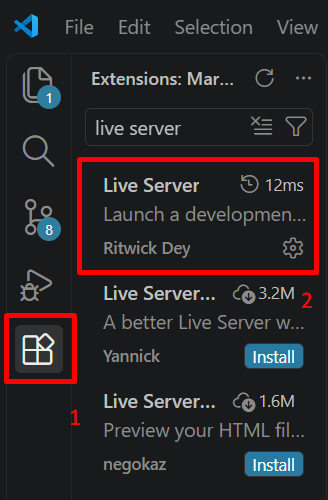
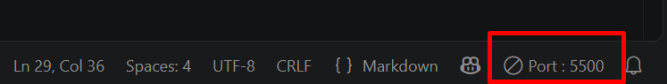
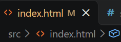
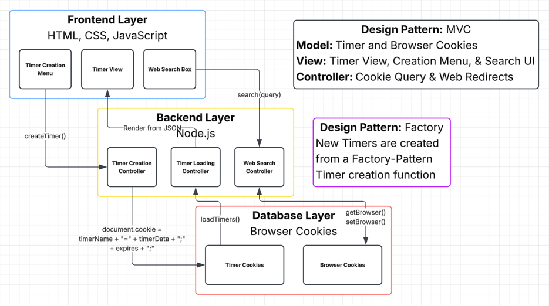

# Every-Second-Counts
Final Assignment for Software Development - Every Second Counts is a webpage that allows users to create and keep track of upcoming deadlines. Intended to replace the user's new tab page.

# Vision
Every Second Counts is a web app that ensures you won’t lose track of time ever again. Users can mark and label specific dates and times down to the second, and watch the clock tick down in real time. Ordinary timer apps - like the one built into your phone - run perpetually in the foreground, often getting in the way; they also usually can only run one timer at a time, are meant only for short durations (no more than a day) and you cannot apply a label to make that timer meaningful. Every Second Counts is designed for you to keep track of big events happening days, months, even years into the future - designed as a replacement for your new tab page, it stays out of the way when it needs to while still keeping you mindful of your time.

Every Second Counts is designed for students and professionals who find themselves constantly running out of time, even when they feel they have time to spare. With Every Second Counts as their homepage, users can set countdowns for any event they desire, and watch the deadline close in every time they open the “New Tab” page, as encouragement and a reminder to stay on task. The web app will be considered successful if it manages to accumulate 100 regular, daily users within its first month.

# Screenshot of Website

# Setup
Visit the website at [every-second-counts.onrender.com](https://every-second-counts.onrender.com/)
**-or-**
Clone the repository using the following command: `git clone https://github.com/C0riux/Every-Second-Counts.git`
Then run it locally using your method of choice. Personally, I use VS Code's "Live Server" extension by Ritwick Dey.
If you are also electing to use that extension, cd into the cloned repository's folder using `cd Every-Second-Counts`
Next, launch VS Code from that directory using `code .`
Then, open the `index.html` file within the `src` directory.
Finally, launch the website using the "Go Live" button in the bottom-right.

**Having Trouble?**
Cant find the "Go Live" button? Make sure you have the "Live Server" extension by Ritwick Dey installed in VS Code. You can install the extension by going to the extensions tab on the left (1), and then searching for "Live Server" in the sidebar (2).

Seeing an Index of the project's root folder instead of a website? You probably didn't have `index.html` opened and in-focus when you hit "Go Live." Return to VS Code and dispose your server using the "Dispose" button, in the same spot that "Go Live" was in.

Then, bring index.html into focus (i.e., bring it into view, as if you were editing it).

And hit "Go Live" again!

# System Architecture:

Given that this is a web app, we are using HTML and CSS to give users a frontend through which they can view and create Timers, as well as search the web. These frontend features create an interface covering FR-1, FR-2, FR-5 and FR-6. The layout of the HTML will also cover NFR-4 by creating an infinitely vertical-scaling space below the Web Search (FR-6) box to display Timers within. Our Node.js backend will enable us to implement the frontend’s functionality, providing for the forementioned FRs as well as some backend-specific ones such as FR-3, FR-4, and NFRs 1 and 2.

Finally, our Database Layer, instead of a traditional database, will leverage browser cookies to achieve persistence (NFR-3) by saving timer and search bar configuration details to the browser. This approach enables us to completely eliminate any operating expense beyond the maintenance of the static site itself, as well as avoiding issues of user accounts and authentication that a serverside database would demand. These cookies will save all data collected as a part of the operation of all previous FRs, ensuring the user experience is the same every time they open the New Tab page.

# Testing Approach:
Functions used within javascript files are copied to their respective test-\[name\] files upon every commit that alters them. New functions that can be tested are added to the exports of said test-\[name\] files.

Not all functions can be tested due to their reliance on input to/from HTML elements; such functions are instead tested manually.

# Current Limitations:
This webapp is currently underdevelopment and is missing multiple core features that will be implemented in future releases, such as: persistence, timer formatting, and timer progression. In addition to adding those functions, I plan to add the ability for users to customize time formats, rearrange timers, assign colors to timers, and change the search engine of the search box.